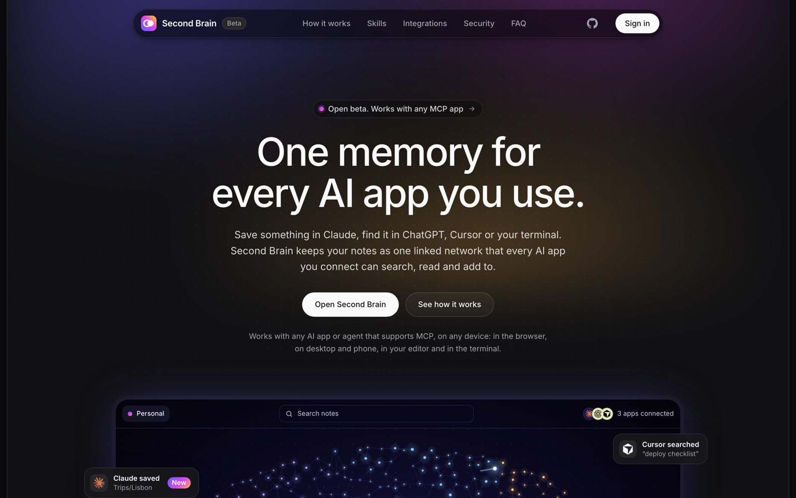

# Second Brain

**One memory for every AI app you use.**

[Website](https://www.getsecondbrain.io) · [Open the app](https://app.getsecondbrain.io) ·
[Security](SECURITY.md) · [License: AGPL-3.0](LICENSE)



Linked markdown notes that every AI app can read and write. Connect Claude, ChatGPT, Cursor, Codex,
Gemini CLI or any MCP client to one remote MCP address, `https://mcp.getsecondbrain.io/mcp`, save
something in one app, and find it from another. Notes live in a workspace you can see as a network
and edit in the browser.

This repository is the full source of the hosted service at
[getsecondbrain.io](https://www.getsecondbrain.io).

## What it does

- **One memory for every AI app.** A remote MCP server with OAuth. You pick a workspace and read or
  read-and-write access when you connect an app, and you can disconnect it at any time.
- **Linked notes.** Obsidian-style `[[wikilinks]]`, tags and frontmatter, with backlinks, renames
  that rewrite links, revisions, a trash and full-text search.
- **Network view.** Every note and link drawn as a live graph in the browser.
- **Skills.** Notes under `Skills/` in the SKILL.md shape become reusable instructions your apps can
  list and load (`list_skills`, `use_skill`, and MCP prompts).
- **Sources.** Granola meeting notes sync in hourly.
- **Safe by default for AI writes.** Every write is attributed to the app and versioned. Apps can
  move a note to the trash but never delete it for good; only you can, in the web app.

MCP tools: `search`, `get_note`, `list_recent`, `get_linked`, `list_tags`, `save_note`,
`update_note`, `append_to_note`, `link_notes`, `trash_note`, `list_skills`, `use_skill`.

## How it is built

One Cloudflare Worker serves four things by hostname: the landing site, the web app and its JSON
API, the OAuth server, and the MCP endpoint.

| Part | Where |
| --- | --- |
| Router, security headers | `src/worker/index.ts` |
| Google sign-in, OAuth server, consent page | `src/worker/auth/` |
| MCP server and tools | `src/worker/mcp/` |
| Workspace store: one SQLite Durable Object per workspace (notes, revisions, links, tags, FTS5, audit) | `src/worker/workspace/` |
| Accounts and memberships (D1) | `src/worker/control/`, `migrations/` |
| Sources (Granola sync) | `src/worker/sources/` |
| Landing site | `src/worker/site/` |
| Web app (React, sigma.js, CodeMirror 6) | `src/web/` |

A workspace id only ever comes from a verified session or OAuth token, never from a request
parameter, and every route and tool has a test that one workspace cannot reach another.

## Run it locally

Requires Node 24 and pnpm.

```sh
pnpm install
pnpm test        # all tests, in the Workers runtime
pnpm dev         # builds the web app and starts the Worker on port 8787
```

Locally the app is at `http://localhost:8787`, the MCP endpoint at `http://127.0.0.1:8787/mcp` and
the landing site at `http://www.localhost:8787`.

Sign-in needs a Google OAuth web client with the redirect URI
`http://localhost:8787/auth/google/callback`. Put the local secrets in `.dev.vars` (never commit it):

```
GOOGLE_CLIENT_ID=...
GOOGLE_CLIENT_SECRET=...
ALLOWED_EMAILS=you@example.com
SOURCES_KEY=...   # openssl rand -base64 32; only needed for Granola
```

`SIGNUP` in `wrangler.jsonc` controls who can join: `"open"` lets any verified Google account in;
any other value allows only `ALLOWED_EMAILS`.

## Deploy your own

1. Create a D1 database and a KV namespace, then put their ids, your `account_id`, your hostnames
   and your origins in the `production` section of `wrangler.jsonc`.
2. Set the secrets: `wrangler secret put GOOGLE_CLIENT_ID --env production`, and the same for
   `GOOGLE_CLIENT_SECRET`, `ALLOWED_EMAILS` and `SOURCES_KEY`.
3. Run `pnpm check` (types, tests, build, deploy dry run), then `pnpm deploy:production`, which
   builds the web app, applies D1 migrations and deploys.

Fair-use limits per workspace (notes, storage, saves a day) are in
`src/worker/workspace/limits.ts`.

## Contributing

Issues and pull requests are welcome. Write the test first, keep one test per scenario, and run
`pnpm types` and `pnpm test` before opening a PR. `AGENTS.md` lists the project's rules (it is also
what coding agents read).

## Security

Please report vulnerabilities privately; see [SECURITY.md](SECURITY.md).

## License

[GNU Affero General Public License v3.0](LICENSE). If you run a modified version as a service, you
must offer its source to your users.
